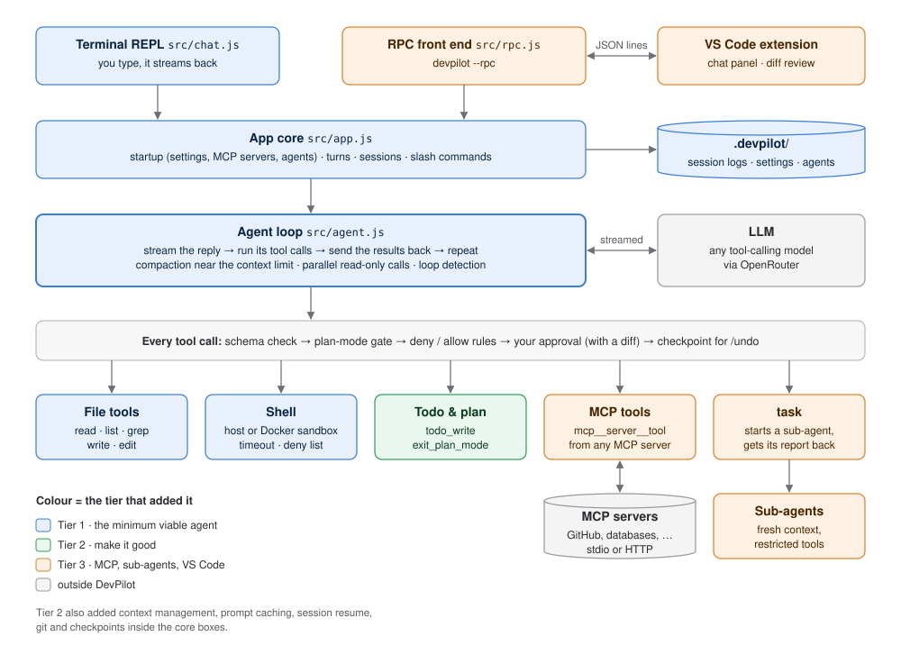
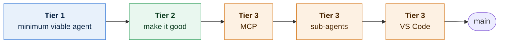
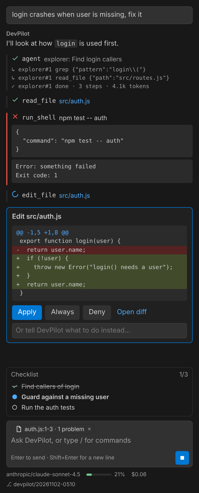

# DevPilot

A coding agent built from scratch, one tier at a time: an LLM in a loop with
tools, pointed at your codebase. It reads and edits code, runs commands and
tests, and asks before it changes anything. It runs in the terminal or in VS Code.

I built it to understand how agents like Claude Code, Codex and GitHub Copilot
really work, so there is **no agent framework**: the loop, the tools, the
context management and the safety checks are all plain JavaScript you can read.

A typical session in the terminal (abridged):

```
You: the login test is failing, fix it

⏺ task {"agent":"explorer","description":"Find login code"}
  ↳ explorer#1 grep {"pattern":"login"}
  ✓ explorer#1 done · 3 steps · 4.1k tokens
⏺ read_file {"path":"src/auth.js"}
⏺ edit_file {"path":"src/auth.js", ...}

--- src/auth.js
+++ src/auth.js
-  return user.name;
+  return user?.name;

? Edit src/auth.js
  [y] yes  [n] no  [a] always allow file edits this session  (or type feedback)
  > y
⏺ run_shell {"command":"npm test"}
? Run: npm test  > y
  ⎿ Exit code: 0
Fixed: login() now handles a missing user. All 12 tests pass.
```

## What it can do

- **Work in your codebase.** Read, search, edit (with a diff you approve) and
  run shell commands, optionally inside a Docker sandbox with no network.
- **Handle long tasks.** It keeps a todo list, compacts the conversation before
  the context fills up, caches the prompt to cut cost, and resumes saved sessions.
- **Stay safe.** It asks before every edit or command, blocks dangerous commands,
  moves off `main` to its own branch before its first edit, and `/undo`
  reverts a whole turn.
- **Plan first** (`/plan`): read-only exploring, then a plan you approve.
- **Delegate to sub-agents:** an `explorer` searches the code in its own
  context and returns a short report; a `reviewer` checks your diff.
- **Use any MCP server** (GitHub, databases, browsers…), configured like Claude Code.
- **Live in VS Code:** a chat panel, proposed edits in the native diff view,
  and your open file, selection and problems sent with each message.

## Architecture



Read it top to bottom. A front end (terminal or VS Code) hands your message to
the **app core**. The **agent loop** streams the model's reply and runs the tools
it asks for. Every tool call goes through the **same safety pipeline**, whether
it comes from the main agent, a sub-agent or an MCP server. The colours show
which tier added each part.

More diagrams (one turn of the loop, a tool call's checks, sub-agents, MCP, the
VS Code protocol, what is saved where): **[docs/ARCHITECTURE.md](docs/ARCHITECTURE.md)**.

## How I built it: tier by tier

Instead of trying to build everything at once, I studied a feature map of
Claude Code, Codex and Copilot, split their features into tiers, and built one
tier at a time. Each tier had to work end to end, with tests, before the next
began. Each tier ended in its own commit, so you can browse or diff the code
exactly as it stood at any stage (the links in the table below):



| Tier | The question it answered | What I added | Lines | Tests |
| --- | --- | --- | --- | --- |
| [**1** · minimum viable agent](https://github.com/siddarthar53/forge/tree/9cff96fb9b82cfa37bd065cb8390dc4b4d21349b) | Can an LLM in a loop change code safely? | Agent loop with streaming tool calls · read, list, grep, edit, shell · y/n/always permissions with diffs · `AGENTS.md` · session logs | 940 | 0 |
| [**2** · make it good](https://github.com/siddarthar53/forge/tree/4d32d67f66fced87540f0ca4f30b81f0f789c92e) | Can I use it for a real, long task? | Todos and plan mode · token counting and auto-compaction · prompt caching · resume · git branch, commit, `/undo` · Docker sandbox and deny list · slash commands · test-fix loop | 2,716 | 21 |
| [**3** · MCP](https://github.com/siddarthar53/forge/tree/09d748bd3f843a7513ed1b2bac09045bcea96931) | Can it use tools I didn't write? | Hand-written MCP client (stdio and HTTP) · server tools become normal tools · trust prompt for project servers | 3,580 | 27 |
| [**3** · sub-agents](https://github.com/siddarthar53/forge/tree/4ec5116378fa25f11921fb9f71e0551ca904ad29) | Can it work in a big codebase without drowning in context? | `task` tool · explorer, reviewer, general and custom agents · restricted toolsets · parallel read-only calls | 4,083 | 34 |
| [**3** · VS Code](https://github.com/siddarthar53/forge/tree/806295a95c1713f22bcb2998ac7459553abc8158) | Can it live where developers work? | App core split from the terminal UI · `--rpc` JSON-lines protocol · VS Code chat panel with native diff review | 5,791 | 41 |

<sub>Lines: JavaScript source, tests excluded. See exactly what a tier added with `git diff 9cff96f 4d32d67 --stat`.</sub>

A few decisions that shaped the whole project:

- **No framework, so every line is explainable.** The loop calls an
  OpenAI-compatible API directly and glues streamed tool-call fragments together
  itself.
- **Refactor only when a feature needs it.** Toolsets arrived with sub-agents,
  and the app/front-end split arrived with VS Code, not before.
- **One safety pipeline for everything.** MCP tools, sub-agents and the editor
  all reuse the permissions, rules and checkpoints from Tiers 1 and 2.
- **Never change the prompt prefix mid-session**, so prompt caching keeps
  working. This is why plan mode is a message reminder, not a new system prompt.

The full story, with the reasoning, trade-offs and the bugs I found at each
step: **[docs/BUILD-LOG.md](docs/BUILD-LOG.md)**.

## Quick start

Needs Node.js 22+ and an [OpenRouter](https://openrouter.ai) API key.

```bash
git clone https://github.com/siddarthar53/forge.git
cd forge
npm install
cp .env.example .env     # add your API key and a tool-calling model
npm start                # chat with DevPilot about its own code
```

Run it on your own project from that project's folder:
`node path/to/forge/index.js`. Type `/help` for commands.

For VS Code, build the extension (`cd vscode-extension && npm install && npm
run package`) and install the `.vsix`.

<details>
<summary>The VS Code chat panel</summary>



<sub>Rendered with sample data using VS Code's Dark+ theme colours.</sub>
</details>

All commands and settings: **[docs/USAGE.md](docs/USAGE.md)**.

## Repository map

```
index.js              entry point: flags, .env config, API client
src/
  chat.js  rpc.js     front ends: terminal, and JSON lines for editors
  app.js              app core: startup, turns, sessions
  agent.js            the agent loop
  commands.js         slash commands
  tools/              the tools, toolsets and schema validation
  safety.js  permissions.js  checkpoints.js  settings.js
  context.js  compact.js  caching.js  session.js  prompt.js
  git.js  testloop.js
  mcp/                MCP client, config, tool adapter
  subagents.js        built-in and custom sub-agents
test/                 node --test suites, incl. scripted model replays
vscode-extension/     the VS Code extension (own README and tests)
docs/                 architecture, build log, usage
```

Start reading at `src/agent.js`: the loop is about 200 lines and explains the
rest.

## Testing

```bash
npm test                                   # 37 tests
cd vscode-extension && npm test            # 4 extension tests
cd vscode-extension && npm run check       # type-check against the VS Code API
```

The tests run without an API key: a scripted fake model streams replies and
tool calls, so the loop, compaction, sub-agents, MCP (against a fixture
server) and the editor protocol are tested end to end.

**Honest status:** everything above is tested with scripted models. The MCP
client was also checked against the official MCP reference server, and the
sandbox against real Docker. Runs with real models, on Windows and inside real
VS Code are the next step.

## What's next

- **Tier 4: evaluation.** A benchmark of 20 to 50 tasks with hidden tests,
  measuring pass rate, steps, tokens and cost, then changing one thing at a time
  (sub-agents on vs off, compaction on vs off) to show the effect. First this
  needs a headless mode (`devpilot -p "<task>" --auto-approve`).
- **Not built yet:** hooks, skills, custom slash commands, web search, `@file`
  mentions, opening PRs, a GitHub Action, OAuth for remote MCP servers.
