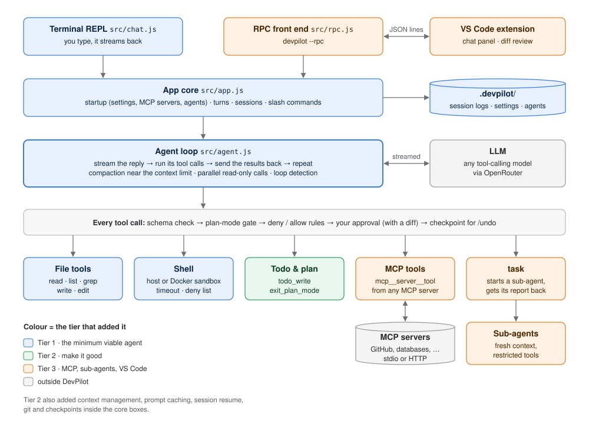
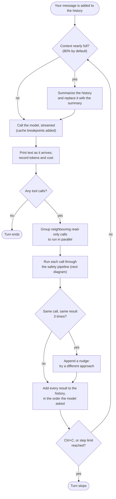
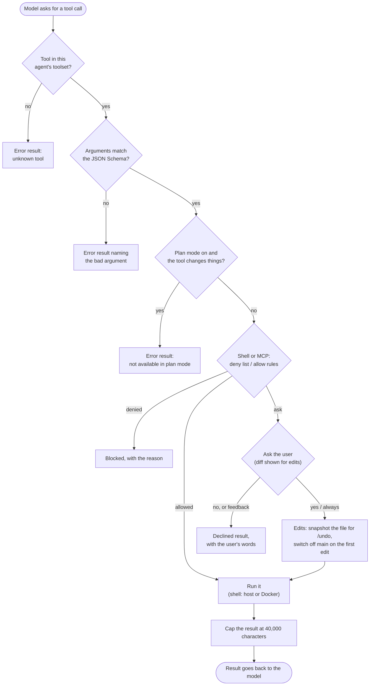
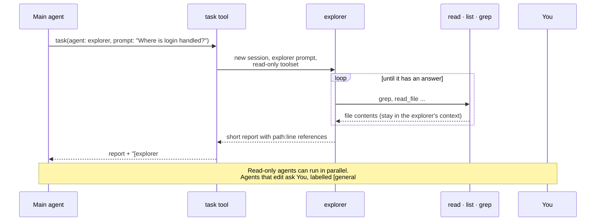
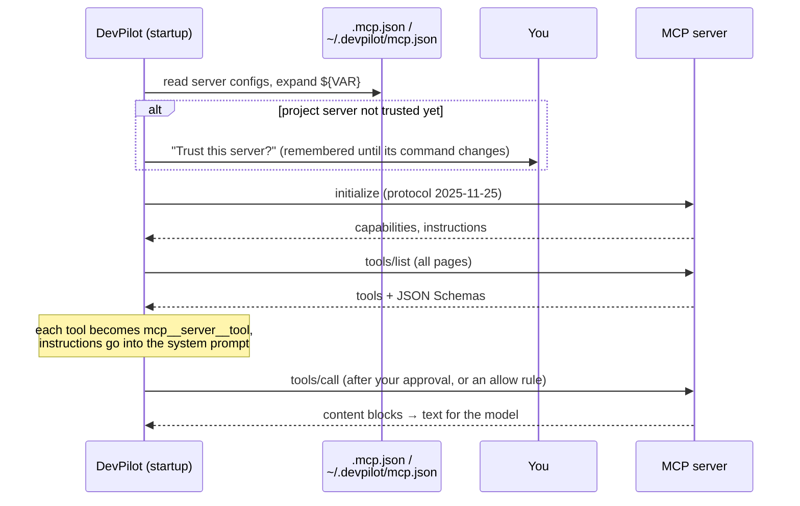
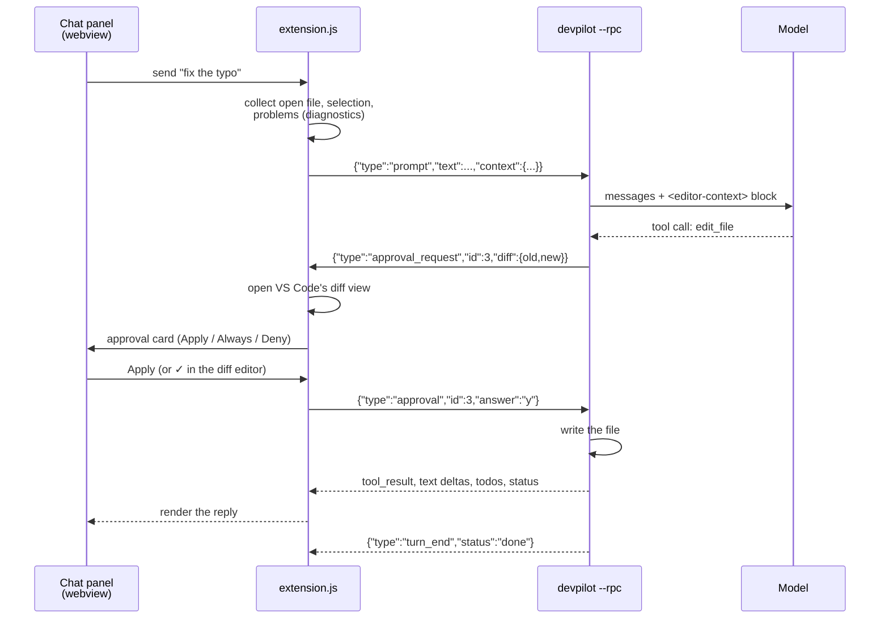

# Architecture

DevPilot is one agent core with two front ends. Everything that thinks, calls
tools and keeps state lives in `src/`; the terminal and VS Code only differ in
how they show output and ask for approval.

- [The big picture](#the-big-picture)
- [One turn of the agent loop](#one-turn-of-the-agent-loop)
- [What happens to one tool call](#what-happens-to-one-tool-call)
- [Sub-agents](#sub-agents)
- [MCP servers](#mcp-servers)
- [VS Code and the `--rpc` protocol](#vs-code-and-the---rpc-protocol)
- [What is saved where](#what-is-saved-where)
- [Module map](#module-map)

## The big picture

Read it top to bottom: a front end hands your message to the app core, the
agent loop talks to the model, and every tool the model calls goes through the
same safety pipeline first. Each box is coloured by the tier that added it.
The diagram is generated by `docs/images/make-architecture.py`.

Three rules hold the design together:

1. **The agent loop knows nothing about the UI.** It reports events (text,
   tool call, result, notice) to a *reporter*, and asks for permission through
   an `approve` function. The terminal, a sub-agent and VS Code each pass their own.
2. **Tools are plain objects** (`name`, `description`, JSON Schema, `run`). Built-in
   tools, MCP tools and the `task` tool look the same to the loop.
3. **The prompt prefix never changes during a session.** The system prompt and tool
   list are fixed at startup, so the provider can cache them. Anything that
   changes (plan mode, todos) travels in messages instead.

## One turn of the agent loop

`runAgent()` in `src/agent.js`. One message from you can take many model calls.

Every `tool_call` in the history must get a matching `tool` result, even when
you press Ctrl+C or DevPilot crashes mid-turn (`repairHistory` in `session.js`
fills the gaps on resume). Otherwise the next API request is rejected.

## What happens to one tool call

`toolset.execute()` in `src/tools/index.js`, then the tool's own `run()`.

Errors are results, not crashes: the model reads them and fixes its call. File
edits also require that the model read the file first, and fail if the file
changed on disk since (`assertFreshRead` in `tools/files.js`).

## Sub-agents

`src/subagents.js`. The `task` tool starts another `runAgent()` with a fresh
history, its own system prompt and a restricted toolset. Only its final report
returns, so reading 30 files costs the main conversation a few hundred tokens.

| Agent | Tools | Runs in parallel / plan mode |
| --- | --- | --- |
| `explorer` | read, list, grep, read-only MCP tools | yes |
| `reviewer` | read tools + `run_shell` | no |
| `general` | everything except `task`, todos, plan | no |
| custom (`.devpilot/agents/*.md`) | what its header lists | if all its tools are read-only |

Sub-agents never get the `task` tool, so they cannot start more sub-agents.

## MCP servers

`src/mcp/`. Servers start before the first model call, so their tools become
part of the fixed tool list.

The JSON-RPC client is written by hand (`mcp/client.js`): requests carry an
`id` and wait in a pending map; notifications don't. Two transports: stdio
(newline-delimited JSON to a child process) and Streamable HTTP (one POST per
message, JSON or event-stream replies, an `Mcp-Session-Id` header). Ctrl+C
and timeouts send `notifications/cancelled`.

## VS Code and the `--rpc` protocol

The extension does not reimplement the agent. It starts `devpilot --rpc` in the
workspace folder and exchanges one JSON object per line over stdin/stdout.

stdout carries only protocol messages; anything the core would print (command
output, notices) is captured and sent as `{"type":"log"}`. The full message list
is at the top of `src/rpc.js`.

## What is saved where

| Path | What | Written by |
| --- | --- | --- |
| `<project>/.devpilot/sessions/*.jsonl` | Every conversation, one event per line: messages, history resets, todos, usage | `session.js` |
| `<project>/.devpilot/subagents/*.jsonl` | Each sub-agent run's own log | `subagents.js` |
| `<project>/.devpilot/settings.json` | Allow/deny rules, test command | you |
| `<project>/.devpilot/agents/*.md` | Custom sub-agents | you |
| `<project>/.mcp.json` | MCP servers for this project | you |
| `<project>/AGENTS.md` | Project instructions added to the system prompt | you |
| `~/.devpilot/` | Your own `settings.json`, `mcp.json`, `agents/`, and `mcp-trust.json` | you / DevPilot |

The model's file tools cannot write inside `.git/` or `.devpilot/`, so it cannot
edit its own permissions or agents. Checkpoints for `/undo` live in memory only.

Resuming a session replays its log: `message` appends, `reset` replaces the
history (after compaction or `/undo`), and a missing tool result left by a
crash is filled in.

## Module map

| Layer | Files |
| --- | --- |
| Entry and front ends | `index.js` (flags, config), `src/chat.js` (terminal), `src/rpc.js` (editors) |
| App core | `src/app.js` (startup, turns, sessions), `src/commands.js` (slash commands), `src/testloop.js` (`/test`) |
| Agent loop | `src/agent.js` (loop, reporters, parallel groups), `src/prompt.js` (system prompt) |
| Context | `src/context.js` (tokens, model info, cost), `src/compact.js`, `src/caching.js`, `src/session.js` |
| Tools | `src/tools/index.js` (toolsets, validation, plan gate), `files.js`, `shell.js`, `todo.js`, `plan.js`, `workspace.js` |
| Safety | `src/safety.js` (deny list, rules), `src/permissions.js` (prompts), `src/settings.js`, `src/checkpoints.js` |
| Git | `src/git.js` (work branch, commit messages) |
| Extensions | `src/mcp/` (client, config, tool adapter), `src/subagents.js` |
| Editor | `vscode-extension/` (see its [README](../vscode-extension/README.md)) |
