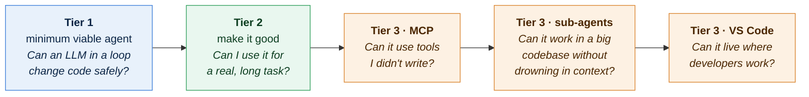

# Build log: how DevPilot was built, tier by tier

I did not try to build a Claude Code clone in one go. I started from a feature
map of three real coding agents (Claude Code, OpenAI Codex, GitHub Copilot),
sorted their features into tiers, and built one tier at a time. **Each tier
had to run and be demo-able before the next one started**, and each lives on
its own commit, so the code at each stage stays browsable (links below):

| Tier (final commit) | Date | Built on | JS source lines | Tests |
| --- | --- | --- | --- | --- |
| [`tier-1` · 9cff96f](https://github.com/siddarthar53/forge/tree/9cff96fb9b82cfa37bd065cb8390dc4b4d21349b) | 2026-10-30 | | 940 | 0 |
| [`tier-2` · 4d32d67](https://github.com/siddarthar53/forge/tree/4d32d67f66fced87540f0ca4f30b81f0f789c92e) | 2026-10-31 | `tier-1` | 2,716 | 21 |
| [`tier-3-mcp` · 09d748b](https://github.com/siddarthar53/forge/tree/09d748bd3f843a7513ed1b2bac09045bcea96931) | 2026-11-02 | `tier-2` | 3,580 | 27 |
| [`tier-3-subagents` · 4ec5116](https://github.com/siddarthar53/forge/tree/4ec5116378fa25f11921fb9f71e0551ca904ad29) | 2026-11-02 | `tier-3-mcp` | 4,083 | 34 |
| [`tier-3-vscode` · 806295a](https://github.com/siddarthar53/forge/tree/806295a95c1713f22bcb2998ac7459553abc8158) | 2026-11-02 | `tier-3-subagents` | 5,791 | 41 |
| `main` (and every branch today) | | all of the above | 5,791 | 41 |

Lines counted over `.js`/`.mjs` files, tests excluded. To see exactly what one tier added: `git diff 9cff96f 4d32d67 --stat`.

## Principles I kept across tiers

1. **Runnable at every step.** A tier is done when it works end to end, has
   tests, and its README explains it. Only then does the next one start.
2. **No agent framework.** The loop calls the OpenAI-compatible API directly
   (through OpenRouter), so I can explain every line: how tool calls stream in,
   how history stays valid, how cancellation works.
3. **Refactor when a feature needs it, not before.** Toolsets arrived with
   sub-agents, the reporter interface when sub-agents needed quieter output,
   and the app/front-end split when VS Code needed a second front end.
4. **Safety is part of the design, not a feature.** Permissions came in Tier 1.
   Every later feature (MCP, sub-agents, the editor) had to go through the same
   approval, rules and checkpoints instead of getting its own.
5. **Keep the prompt prefix stable.** Once caching existed (Tier 2), nothing may
   change the system prompt or tool list mid-session. This decided how plan mode,
   MCP and sub-agents were built.
6. **Test the loop without a model.** Tests replay scripted model streams, so
   the whole loop (streaming, tool calls, compaction, sub-agents, the editor
   protocol) is checked without an API key or network.

---

## Tier 1: the minimum viable agent

**Question:** can an LLM in a loop with tools change code safely?

**What I built:** a terminal chat with streaming; the agent loop; five tools
(read file, list/glob, grep, write/edit, shell); a y / n / always permission
prompt with a coloured diff before edits; a system prompt with environment info
plus the project's `AGENTS.md`; a step limit, error handling, Ctrl+C; every
session logged to a JSONL file.

**Decisions:**

- **String-replace edits** (`old_string` must be unique) instead of rewriting
  files or applying patches. Uniqueness forces the model to quote enough
  context, and a failed match is a clear error it can fix.
- **Read before write, plus stale detection.** An edit requires that the model
  read the file this session, and fails if the file changed on disk since.
- **Errors are results.** A bad tool call returns text the model can read and
  correct; it never crashes the loop.
- **History must stay valid.** Every `tool_call` gets a matching `tool`
  message, even when cancelled, or the next API request is rejected.
- **Bounded tools.** Caps on lines read, matches, output size and command time.

**Concepts:**

1. **Tool calling.** The model never runs anything itself; our code does.
2. **Streaming tool calls.** Arguments arrive in fragments and are glued
   together by `index` (`agent.js` → `streamAssistantMessage`).
3. **Valid history** (see above).
4. **Errors are results.**
5. **String-replace edits.**
6. **Read-before-write and stale detection** (`files.js` → `assertFreshRead`).
7. **Permissions.** Read-only tools run freely; edits and commands ask.
8. **Bounded tools.**
9. **Prompt-injection awareness.** Tool output is data, not instructions;
   `.env` files are never read.
10. **Cancellation.** One `AbortController` per turn.

**What I found later:** in Tier 1, pressing Ctrl+C while a permission prompt
was open did not cancel it, and if you then typed `y` the command still ran.
The signal was never passed to the prompt. I confirmed it with a test and fixed
it in Tier 2. Commit `9cff96f` keeps Tier 1 exactly as built, bug included.

---

## Tier 2: make it good

**Question:** can I actually use it for a real, long task?

**What I built:** a todo tool and plan mode; token counting, output caps and
auto-compaction; prompt caching; session resume; git integration (a work
branch, commits with generated messages, checkpoints and `/undo`); a Docker
sandbox and a deny list; slash commands; a test-fix loop.

**Decisions:**

- **Count tokens from the API, estimate only the gap.** The API reports exact
  prompt tokens after each call; only messages added since are estimated (about
  4 characters per token). No tokenizer per model family.
- **Compaction = summary + replace.** Near 80% of the window, the model writes
  a structured summary (requests, decisions, files, errors, next steps) that
  replaces the history. File reads are forgotten too, so edits require a re-read.
- **Plan mode without changing the prompt.** Turning plan mode on adds a
  reminder to your message and blocks non-read-only tools in code. The system
  prompt and tool list stay identical, so caching keeps working.
- **The test loop is driven by DevPilot, not the model.** DevPilot runs the
  tests itself, so the model cannot declare victory without them passing.
- **Allow rules only for simple commands.** An allow rule for `npm test` must not
  also allow `npm test && rm -rf src`, so chains, pipes and redirects always ask.
- **A seat belt, not a sandbox.** The deny list catches obvious disasters; the
  real isolation is Docker with no network and only the workspace mounted.

**Concepts:**

11. **Todo list** (`tools/todo.js`). The model sends the full list each time.
12. **Plan mode** (`tools/plan.js`, the gate in `tools/index.js`).
13. **Token counting** (`context.js`, `session.js`).
14. **Auto-compaction** (`compact.js`).
15. **Prompt caching** (`caching.js`). OpenAI-style providers cache repeated
    prefixes automatically; Claude needs `cache_control` breakpoints, added to a
    copy of the messages at request time.
16. **Session resume** (`session.js`). The JSONL log is replayed: `message`
    appends, `reset` replaces the history.
17. **Git integration** (`git.js`). A `devpilot/*` branch before the first edit
    on main; secrets and `.devpilot/` are never committed.
18. **Checkpoints** (`checkpoints.js`). The bytes of each file before its first
    change in a turn; `/undo` restores them and rewinds the conversation.
19. **Sandbox and deny list** (`tools/shell.js`, `safety.js`).
20. **Test-fix loop** (`testloop.js`).
21. **Loop detection** (`agent.js`). The same call with the same result three
    times in a turn gets a nudge to change approach.
22. **`.gitignore` support** in `list_files` and `grep` via `git check-ignore`.

**Bugs found while building:**

- The deny list missed `rm -rf /` when `rm` was at the very start of the
  command (the regex expected whitespace before the flag). A test caught it.
- `/commit` would have committed `.devpilot/` session logs, which contain whole
  conversations. Found in an end-to-end run; now excluded, like `.env`.
- The test suite once hid two results because a helper silenced stdout, which
  the test runner itself uses. Output now goes through a `terminal` object that
  tests can replace.

---

## Tier 3: stand-out features

The feature map offered eight Tier 3 options. I picked three that build on each
other, and built each on top of the previous one:

- **MCP:** the standard way to plug in tools and data, supported by all three
  products. It makes the agent extensible without me writing every tool.
- **Sub-agents:** context is the hardest problem in agents. Isolating noisy
  work in a sub-agent is the main fix the real products use.
- **A VS Code extension:** where developers actually work, and a test of whether
  the core is really independent of the terminal.

### Tier 3 · MCP

**What I built:** a hand-written MCP client (JSON-RPC 2.0) with stdio and
Streamable HTTP transports; server tools turned into ordinary DevPilot tools;
`.mcp.json` config with `${VAR}` expansion, per-server tool allow-lists and a
trust prompt for project servers; `/mcp`.

**Decisions:**

- **Write the protocol client by hand** rather than use the SDK, so the
  handshake, pending-request map, pagination and cancellation are visible code.
- **Tools are data.** A server tool becomes `mcp__<server>__<tool>` with the
  server's own description and schema; the agent loop does not know the difference.
- **Connect before the first model call** so the tool list stays fixed and the
  prompt cache keeps working. A server that announces new tools is noted in `/mcp`.
- **Trust boundaries.** A project's `.mcp.json` can start any program, so each
  server must be trusted once, and again if its command changes.

**Concepts:** 23. JSON-RPC by hand · 24. two transports · 25. tools are data ·
26. a stable tool list · 27. trust boundaries.

**Verified** against the official MCP reference server (`server-everything`)
over both transports: tool calls, image results, paginated resources, and
cancelling a slow call mid-flight.

**Bug found:** the test runner hung because `node --test` treats every file
under `test/` as a test, including the fixture MCP server, which then waited
for input forever. Tests now match `test/*.test.js` only.

### Tier 3 · sub-agents

**What I built:** a `task` tool that starts a sub-agent with its own context
and a restricted toolset; built-in `explorer`, `reviewer` and `general`
agents; custom agents from `.devpilot/agents/*.md`; parallel execution of
read-only calls; `/agents`.

**Refactors this needed first:**

- **Toolsets.** A model only sees, and can only call, the tools in its own
  toolset, so "read-only" is enforced, not requested.
- **Reporters.** The loop reports events instead of printing, so a sub-agent's
  progress can show as short labelled lines.
- **A permission queue.** Parallel sub-agents may want approval at the same
  moment; prompts now wait in line.

**Decisions:**

- **A sub-agent is just `runAgent()` again** with a new session, prompt and
  toolset. No second loop to maintain.
- **No nesting.** Sub-agents never get the `task` tool.
- **Shared safety.** Sub-agents use the same prompts (labelled
  `[explorer#2]`), rules, sandbox and `/undo` checkpoint; their cost goes to `/cost`.

**Concepts:** 28. context isolation · 29. toolsets · 30. parallel tool calls
(`groupForParallel`) · 31. shared safety · 32. reporters.

### Tier 3 · VS Code extension

**What I built:** `devpilot --rpc` (a JSON-lines protocol over stdin/stdout)
and a VS Code extension around it: a chat panel, proposed edits in VS Code's
diff view, and the open file, selection and diagnostics sent with each message.

**Refactor this needed first:** splitting `chat.js` into an app core
(`app.js`) and front ends (`chat.js` for the terminal, `rpc.js` for editors).
Both give the app the same three things: `ask`, `approve` and a reporter.

**Decisions:**

- **A protocol, not a second agent.** The extension starts the real agent as a
  child process (as the Codex extension does with its app server), so there is
  one implementation and the extension stays small.
- **stdout belongs to the protocol.** Anything the core would print is captured
  and sent as a `log` event, so nothing corrupts the stream.
- **Editor context as data.** The extension sends structure (path, selection,
  diagnostics); DevPilot turns it into an `<editor-context>` block.
- **Native diff review.** Proposed edits open in VS Code's diff view, with
  accept and reject buttons in the editor title bar.

**Concepts:** 33. one core, two front ends · 34. a protocol instead of a
library · 35. editor context as data · 36. native diff review.

**How it was checked:** VS Code itself could not run in the build environment,
so the extension's calls are type-checked against the official `@types/vscode`,
its logic is tested against the real agent behind a stand-in `vscode` module,
and the chat panel was rendered in Chromium with VS Code's theme colours.

**Bugs found:** the first `todos` event sent an empty list; the todo list was
also repeated as log lines in the editor. Both caught by the protocol tests.

---

## What is next

- **Tier 4: evaluation.** A benchmark of 20 to 50 tasks with hidden tests,
  recording pass rate, steps, tokens and cost, then one change at a time
  (explorers on vs off, compaction on vs off) to show the numbers move. This
  needs a headless mode (`devpilot -p "<task>" --auto-approve`) first.
- **Not built (out of scope for now):** hooks, skills, custom slash commands,
  web fetch and search, an ask-user tool, `@file` mentions, opening PRs, a
  GitHub Action, OAuth for remote MCP servers.
